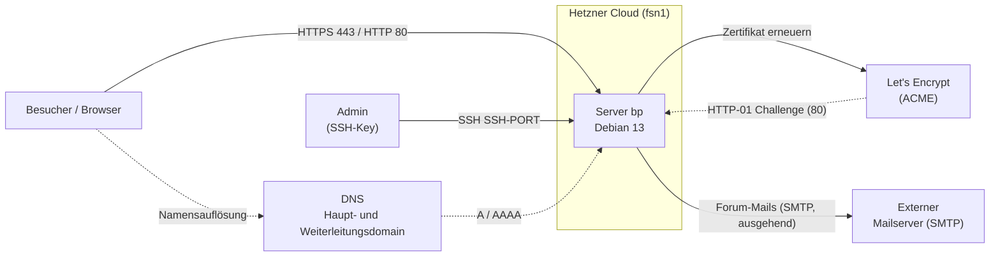
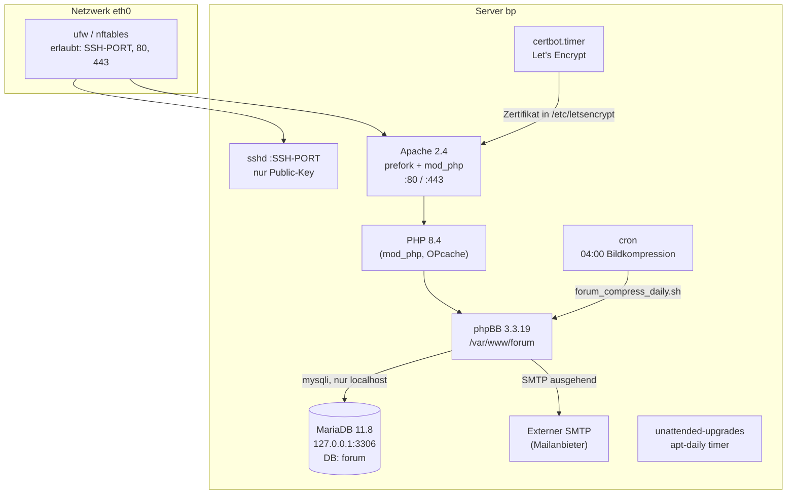
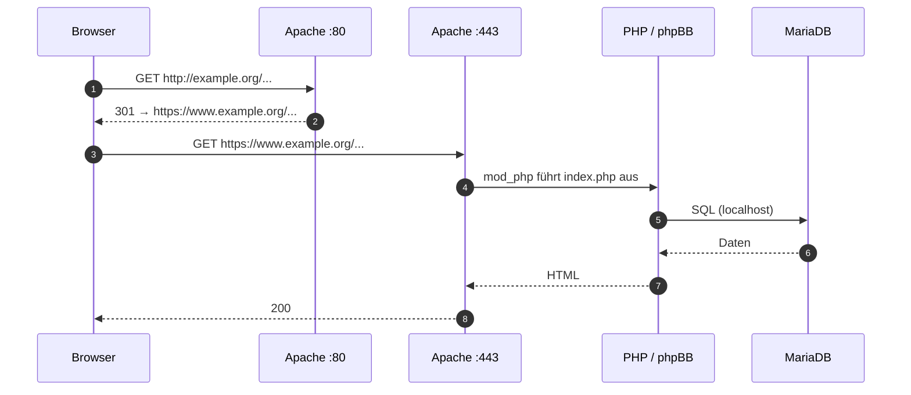
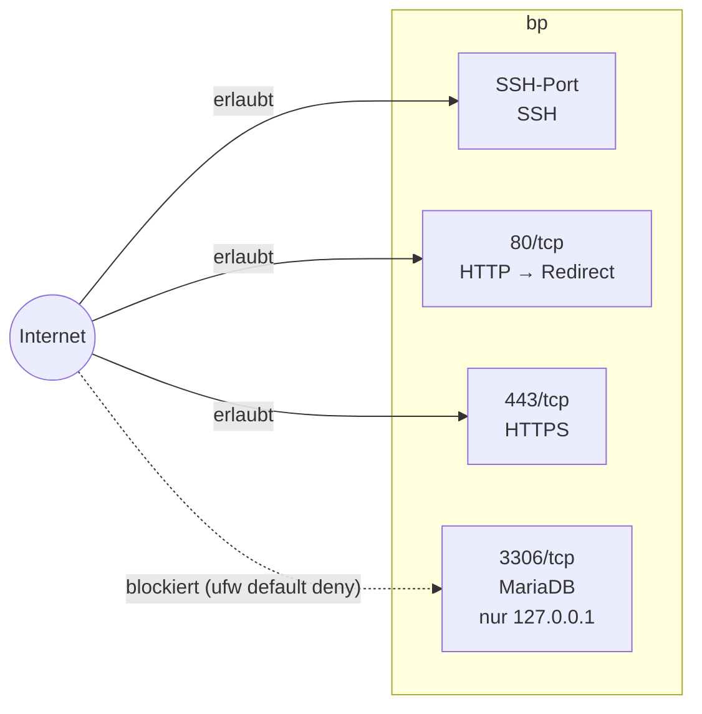
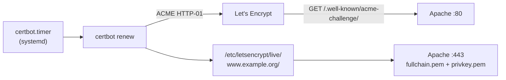
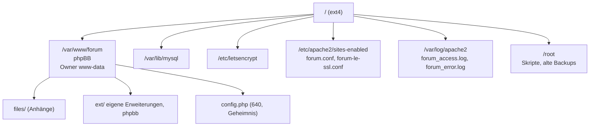

# 01 – Architektur

Alle Diagramme sind Mermaid. Sie beschreiben die Architektur eines phpBB-Forums auf einem einzelnen Debian-Server. Konkrete Adressen und der SSH-Port sind bewusst weggelassen.

## 1. Systemkontext

## 2. Komponenten auf dem Server

## 3. Request-Fluss

`example.com` / `www.example.com` werden per 301 auf `https://www.example.org` umgeleitet (ACME-Pfad `/.well-known/acme-challenge/` bleibt ausgenommen).

## 4. Netzwerk und Ports

| Port | Dienst | Erreichbar von |
|---|---|---|
| SSH-Port (frei gewählt) | sshd | überall (IPv4 + IPv6), nur Key-Login |
| 80/tcp | Apache | überall, leitet auf HTTPS um |
| 443/tcp | Apache | überall |
| 3306/tcp | MariaDB | nur `127.0.0.1` |

## 5. Zertifikate (TLS)

Ein SAN-Zertifikat (ECDSA) für vier Namen: `www.example.org`, `example.org`, `www.example.com`, `example.com`.

## 6. Verzeichnis- und Datenlayout

