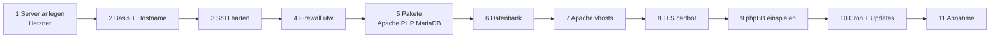

# 02 – Bereitstellung (Runbook)

Anleitung, um einen phpBB-Server nach diesem Muster aufzubauen. Sie ist aus einem laufenden System rekonstruiert, aber nicht als Ganzes durch einen Neuaufbau getestet.



Platzhalter: `<DB_PASSWORT>` wird neu erzeugt und im Passwortmanager abgelegt, nie ins Repo. `${SSH_PORT}` ist ein frei gewählter SSH-Port. Vorlagen liegen unter `templates/`.

## 1. Server anlegen (Hetzner Cloud)

- Image: Debian 13, Standort `fsn1`, ca. 2 vCPU / 4 GB RAM / 38 GB Disk, IPv4 + IPv6.
- SSH-Public-Key des Admins bei der Erstellung hinterlegen.
- DNS: `A`/`AAAA` für `bluemchenpfluecker.de`, `www.bluemchenpfluecker.de`, `bluemchenpfluecker.com`, `www.bluemchenpfluecker.com` auf die Server-IP.
- Reverse-DNS (PTR) der IPv4 auf `www.bluemchenpfluecker.de` setzen.

## 2. Basis und Hostname

```bash
hostnamectl set-hostname bp
# /etc/hosts: FQDN zuerst, dann Kurzname
sed -i 's/^127\.0\.1\.1 .*/127.0.1.1 www.bluemchenpfluecker.de bp/' /etc/hosts
install -m 644 templates/cloud-init/99-bluemchen-hostname.cfg /etc/cloud/cloud.cfg.d/
apt update && apt full-upgrade -y
```

`preserve_hostname: true` und `manage_etc_hosts: false` verhindern, dass cloud-init Hostname und `/etc/hosts` beim Boot zurücksetzt. Der Hostname ist der Kurzname, der FQDN steht als erster Name in `/etc/hosts`.

## 3. SSH härten

```bash
install -m 644 templates/ssh/99-hardening.conf /etc/ssh/sshd_config.d/
sed -i "s/^#\?Port .*/Port ${SSH_PORT}/" /etc/ssh/sshd_config
sshd -t && systemctl reload ssh
```

Vor dem Neuladen eine **zweite Sitzung offen halten** und den Login in einem dritten Fenster testen, um sich nicht auszusperren.

## 4. Firewall (ufw)

```bash
apt install -y ufw
ufw default deny incoming
ufw default allow outgoing
ufw allow "${SSH_PORT}"/tcp comment 'SSH'
ufw allow 80/tcp    comment 'HTTP'
ufw allow 443/tcp   comment 'HTTPS'
ufw enable
```

## 5. Pakete

```bash
apt install -y apache2 libapache2-mod-php8.4 php8.4 \
  php8.4-mysql php8.4-gd php8.4-xml php8.4-mbstring php8.4-curl php8.4-zip php8.4-gmp \
  mariadb-server certbot python3-certbot-apache \
  unattended-upgrades rsync
a2enmod rewrite ssl deflate
```

> Die Paketliste ist aus `php -m` und `dpkg -l` abgeleitet. Vor dem Produktiveinsatz gegen das Zielsystem prüfen.

## 6. Datenbank

```bash
mariadb-secure-installation        # root nur per unix_socket, anonyme User entfernen
mariadb <<'SQL'
CREATE DATABASE bluemchen CHARACTER SET utf8mb4 COLLATE utf8mb4_bin;
CREATE USER 'bluemchen'@'localhost' IDENTIFIED BY '<DB_PASSWORT>';
GRANT ALL PRIVILEGES ON bluemchen.* TO 'bluemchen'@'localhost';
SQL
```

- `bind-address = 127.0.0.1` (Standard in `50-server.cnf`) beibehalten.
- Zeichensatz/Collation passend zur phpBB-Version wählen; phpBB 3.3 nutzt normalerweise `utf8mb4` / `utf8mb4_bin`.

## 7. Apache

```bash
install -m 644 templates/apache/forum.conf        /etc/apache2/sites-available/
install -m 644 templates/apache/forum-le-ssl.conf /etc/apache2/sites-available/
a2dissite 000-default
a2ensite forum
```

`forum-le-ssl.conf` erst aktivieren, **nachdem** das Zertifikat existiert (Schritt 8), sonst startet Apache nicht.

## 8. TLS mit Let's Encrypt

```bash
certbot certonly --apache \
  -d www.bluemchenpfluecker.de -d bluemchenpfluecker.de \
  -d www.bluemchenpfluecker.com -d bluemchenpfluecker.com \
  --key-type ecdsa
a2ensite forum-le-ssl
apachectl configtest && systemctl reload apache2
systemctl list-timers certbot.timer
certbot renew --dry-run
```

## 9. phpBB einspielen

Neuaufbau aus Backup (Datenbank + Dateien), nicht per Neuinstallation:

```bash
mkdir -p /var/www/forum
# Dateien aus dem Backup zurückspielen (Quelle: Backup-Volume bzw. Archiv)
rsync -a <BACKUP>/forum/ /var/www/forum/
chown -R www-data:www-data /var/www/forum
chmod 640 /var/www/forum/config.php
# Datenbank
mariadb bluemchen < <BACKUP>/bluemchen.sql
# phpBB-Cache leeren
rm -rf /var/www/forum/cache/production/*
```

- `config.php` enthält die DB-Zugangsdaten und muss zum neuen `<DB_PASSWORT>` passen.
- Erweiterungen: `ext/bluemchen/{banner,blumenicons,impressum}`, `ext/phpbb/webpushnotifications` im ACP aktivieren bzw. prüfen.
- Danach im ACP den Cache leeren und die Boardeinstellungen (Domain, Cookie-Domain, Server-Protokoll `https`) prüfen.

## 10. Cron und automatische Updates

```bash
install -m 644 templates/cron.d/forum-compress /etc/cron.d/forum-compress
# /usr/local/bin/forum_compress_daily.sh aus dem Backup/der Quelle einspielen
dpkg-reconfigure -plow unattended-upgrades
```

Erwartete `/etc/apt/apt.conf.d/20auto-upgrades`:

```
APT::Periodic::Update-Package-Lists "1";
APT::Periodic::Unattended-Upgrade "1";
APT::Periodic::AutocleanInterval "7";
```

## 11. Abnahme

Siehe Checkliste in [03-betrieb.md](03-betrieb.md#abnahme-nach-reboot-oder-neuaufbau).
